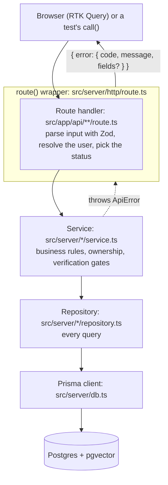

# Pencil

A multi-author blog: one Next.js app serving both the UI and a REST API, on Postgres (with pgvector), S3-compatible storage and SMTP email. The full spec is [issue #1](https://github.com/ja03/pencil/issues/1).

**Live:** <https://pencil-6ygu.onrender.com>. It runs on Render's free tier, so the first request after 15 idle minutes takes about a minute while the service wakes up.

- [Run it](#run-it) · [Develop](#develop)
- [Architecture](#architecture) · [Design patterns](#design-patterns)
- [Google sign-in](#google-sign-in) · [AI recommendations](#ai-recommendations)
- [Test](#test) · [Deploy](#deploy) · [Decisions](#decisions)

## Run it

```bash
docker compose up
```

This starts the app on <http://localhost:3000> along with Postgres (host port 5433), MinIO (<http://localhost:9001>, `pencil` / `pencil-secret`) and Mailpit (<http://localhost:8025>), then runs migrations and the seed.

The seed adds published demo posts and four verified demo authors, so publishing works straight away. Log in as `lina.k@pencil.local` (or `omar.h`, `devnotes`, `sara.m` at `pencil.local`) with the password `pencil-demo`.

## Develop

```bash
cp .env.example .env
docker compose up -d postgres minio mailpit
npm install
npx prisma migrate deploy
npm run db:seed   # creates the bucket and lets browsers read uploaded images
npm run dev
```

## Architecture

One Next.js 16 app (App Router, React 19) holds the pages and the REST API. Pages render on the server and the browser talks to the API with RTK Query. Everything the app stores goes through three services, chosen by environment variables, so the same code runs locally and in production:

| Concern | Locally (`docker compose`) | Production |
| --- | --- | --- |
| Database | Postgres 17 with pgvector | Neon |
| Images | MinIO | Cloudflare R2 |
| Email | Mailpit | Mailtrap |

### Request layering

Every create, read, update and delete is a REST route handler under `src/app/api/**`. A request passes down four layers, and each layer only calls the one below it:



- **Route handler** (`src/app/api/posts/route.ts` and the rest): parses and validates input with the Zod schemas in `src/contracts/`, resolves the signed-in user with `getCurrentUser` or `requireUser` (`src/server/auth/service.ts`), calls one service function and returns its result as JSON.
- **Service** (`src/server/<area>/service.ts`): enforces the rules. Examples: a draft is 404 to anyone but its author, publishing needs a verified email (403), and only a comment's author or the post's author may delete a comment.
- **Repository** (`src/server/<area>/repository.ts`): holds every Prisma query for its area, including the `deletedAt: null` filters, so no service writes a query.
- **Contracts** (`src/contracts/`): the Zod schemas and the request and response types, shared by the handlers and the client. They are the only source of validated input types.

The areas are `auth`, `comments`, `embeddings`, `health`, `likes`, `posts`, `recommendations`, `tokens`, `uploads` and `users`. `src/server/http/` holds the shared HTTP pieces: the `route()` wrapper, `ApiError`, cursors and client-IP parsing.

### One error shape

Every failure leaves as `{ error: { code, message, fields? } }`, with the status taken from `ERROR_STATUS` in `src/contracts/api-error.ts`:

| Status | Code | When |
| --- | --- | --- |
| 400 | `VALIDATION_FAILED` | The body or query failed validation; `fields` says which inputs |
| 401 | `UNAUTHENTICATED` | Not signed in, or the session is stale |
| 403 | `FORBIDDEN` | Unverified, or not the owner |
| 404 | `NOT_FOUND` | Missing, someone else's draft, or soft-deleted |
| 409 | `CONFLICT` | A conflict, such as an email already registered |
| 429 | `RATE_LIMITED` | Too many requests; `Retry-After` says when to try again |
| 500 | `INTERNAL` | Anything unexpected; the details go to the server log only |
| 503 | `SERVICE_UNAVAILABLE` | `/api/health` when the database or bucket can't be reached |

An `/api` path with no route of its own gets a JSON 404 from `src/app/api/[...path]/route.ts`, not the HTML 404 page.

### Sessions

A session is a signed JWT in an HTTP-only cookie (`src/server/auth/session.ts`). It carries the user's `tokenVersion`. Resetting a password bumps that version, and so does Google sign-in taking over an unverified account with the same email, which makes every older cookie stale. Checking the version needs the database, so it happens in two places:

- `src/proxy.ts` (see [Middleware](#middleware)) only checks the signature and expiry, so it can turn signed-out visitors away early.
- The full check runs on the server: `requireUser` for API routes (401) and `requirePageUser` in `src/server/auth/page-guard.ts` for pages (redirects to `/login` or `/session-expired`).

## Design patterns

The spec asks for five patterns. Each one below is in the code for a reason, not for its own sake.

### Singleton

**What:** one shared instance of a class for the whole process, created the first time it is needed.

**Where:** the Prisma client in `src/server/db.ts`, the S3 client in `src/server/storage.ts` and the SMTP transport in `src/server/mail/mailer.ts`.

**Why:** each client holds a connection pool. A new client per request would open new connections until Postgres ran out. In development, Next reloads modules on every edit, which would also leak a pool each time. So each instance is kept on `globalThis`, which survives hot reloads.

```ts
// src/server/db.ts
const globalForDb = globalThis as unknown as { prisma?: PrismaClient };

export function db(): PrismaClient {
  globalForDb.prisma ??= new PrismaClient({
    adapter: new PrismaPg({ connectionString: env().DATABASE_URL }),
  });
  return globalForDb.prisma;
}
```

The client is built inside a function, not at import time, so importing a module never needs the environment variables to be set (the production image is built without them).

### Repository + Service

**What:** a repository holds all the data access for one area behind plain functions. A service holds the business rules and calls repositories, never Prisma.

**Where:** `src/server/<area>/repository.ts` and `src/server/<area>/service.ts`, called from the route handlers in `src/app/api/**`. See [Request layering](#request-layering).

**Why:** each layer can change on its own. Rules such as "drafts are 404 to everyone but their author" or "unverified users can't publish" live in one place, the service, whichever route reaches them. Query details, such as leaving out soft-deleted rows or the feed's keyset cursor, live in the repository. The route handler only deals with HTTP.

```ts
// src/app/api/posts/route.ts: HTTP only
export const POST = route(async (request) => {
  const user = await requireUser(request.cookies);
  const input = await parseJson(request, serverPostInputs().createPostInput);
  const body: PostResponse = { post: await createDraft(user, input) };
  return Response.json(body, { status: 201 });
});

// src/server/posts/service.ts: the rules, then the repository
export async function createDraft(author: CurrentUser, input: CreatePostInput): Promise<Post> {
  const row = await posts.createPost(slugify(input.title), {
    authorId: author.id,
    // ...
  });
  return toPost(row, false);
}

// src/server/posts/repository.ts: the query
export function findPostById(id: string): Promise<PostRow | null> {
  return db().post.findFirst({ where: { id, deletedAt: null }, include: withAuthorAndTags });
}
```

### Factory

**What:** a function that decides which object to build and builds it, so callers don't need to know which one they get or how it's made.

**Where:**

- `makeStore()` in `src/client/store.ts` builds a Redux store. `StoreProvider` (`src/client/store-provider.tsx`) calls it once per render tree, seeded with the user the server already resolved.
- `createRecommendationStrategy()` in `src/server/recommendations/factory.ts` picks a [strategy](#strategy) for the recommendation service.

**Why:**

- A module-level store would be shared by every request the server renders, so one visitor's signed-in state could appear on another visitor's page. A factory gives each request its own store.
- The recommendation service shouldn't care whether AI is configured. The factory looks at the embedding provider once and returns the right strategy.

```ts
// src/server/recommendations/factory.ts
export function createRecommendationStrategy(
  provider: EmbeddingProvider | null,
): RecommendationStrategy {
  return provider ? new EmbeddingStrategy() : new TagOverlapStrategy();
}
```

### Middleware

**What:** code that wraps a request on its way in or out, so a concern that applies to many routes is written once.

**Where:**

- `src/proxy.ts`: the page auth guard. In Next 16, `proxy.ts` replaces `middleware.ts`. It runs before `/settings`, `/my-posts` and `/write` render, and sends a visitor with no valid session token to `/login`, or to `/session-expired` when their token has expired or been tampered with. It skips `/api`, because API routes answer with JSON, not redirects.
- `route()` in `src/server/http/route.ts`: wraps every route handler. It turns whatever a handler throws into the one error shape: an `ApiError` keeps its code, a `ZodError` becomes a 400 with field errors, and anything else becomes a 500 with a generic message.

**Why:** without them, every protected page would repeat the redirect logic and every handler would need the same `try`/`catch`. The proxy stays free of database access, so it is fast and can't decide a stale session is valid: it only redirects early, and the full check runs on the server (see [Sessions](#sessions)).

```ts
// src/server/http/route.ts
export function route<Ctx>(handler: Handler<Ctx>): Handler<Ctx> {
  return async (request, context) => {
    try {
      return await handler(request, context);
    } catch (error) {
      unstable_rethrow(error); // let Next's own control-flow throws through
      if (error instanceof ApiError) {
        return errorResponse(error.code, error.message, error.fields, error.headers);
      }
      if (error instanceof z.ZodError) {
        return errorResponse("VALIDATION_FAILED", "Some fields are invalid.", fieldErrors(error));
      }
      console.error(error);
      return errorResponse("INTERNAL", "Something went wrong. Please try again.");
    }
  };
}
```

### Strategy

**What:** a family of interchangeable algorithms behind one interface, so the caller can switch between them without changing its own code.

**Where:** the `RecommendationStrategy` interface in `src/server/recommendations/strategy.ts`, with two implementations:

- `TagOverlapStrategy` (`tag-overlap.ts`): ranks posts by how many tags they share.
- `EmbeddingStrategy` (`embedding.ts`): ranks posts by meaning, finding the nearest pgvector neighbours. It falls back to tag overlap until there is a vector to go on.

**Why:** AI recommendations are optional. They need a Gemini key and could be dropped from the build, while tag overlap always works. Both strategies return post ids and apply the same exclusions: never drafts, deleted posts, the viewer's own posts or posts the viewer already liked. So `src/server/recommendations/service.ts` treats them the same way, and tops the list up with the last 30 days' most-liked posts when a strategy returns too few.

```ts
// src/server/recommendations/strategy.ts
export interface RecommendationStrategy {
  /** Up to `take` posts `user` hasn't seen, picked from the posts they liked. */
  recommendForUser(user: Ref, take: number): Promise<string[]>;
  /** Up to `take` posts like `post`, for `viewer` (null when logged out). Never `post` itself. */
  similarTo(post: Ref, viewer: Ref | null, take: number): Promise<string[]>;
}
```

## Google sign-in

"Continue with Google" appears on the login and register pages only when `GOOGLE_CLIENT_ID` is set on the server, so it is off locally and in tests. In Google Cloud, create an OAuth client of type "Web application" and add the site's address (for example `https://pencil-6ygu.onrender.com`) as an authorized JavaScript origin; no redirect URI or client secret is needed. The browser gets an ID token from Google and `POST /api/auth/google` verifies it against Google's keys.

## AI recommendations

"Recommended for you" and "More like this" pick posts by meaning when `GEMINI_API_KEY` is set in `.env` (or on the server). Each post is embedded with Gemini `gemini-embedding-001` after it is published, and again when its title, description or tags change. Without a key, recommendations use tag overlap.

Posts published before the key was set, or whose embedding failed, have no vector yet. To embed them:

```bash
npm run embeddings:backfill
```

It only touches published posts missing a vector, so it is safe to run again.

## Test

```bash
docker compose up -d postgres minio mailpit
npm test
```

Tests call the REST route handlers against the real services from `docker compose`, using a separate `pencil_test` database and `pencil-test` bucket. Emails the app sends are read back from Mailpit's API.

### Approach

The main test seam is the REST route handlers. A feature test in `tests/features/` builds a real `Request`, passes it to the handler with `call()` from `tests/helpers/request.ts`, and checks the status, the JSON body and the side effects: rows in the database, objects in the bucket, emails in Mailpit. It never checks which internal functions were called, so the services and repositories can be reorganised without touching the tests.

- **Real services, no fake repositories.** The tests run against Postgres with pgvector, MinIO and Mailpit. `tests/setup/global.ts` migrates the test database, creates the bucket and empties Mailpit once per run. `tests/setup/each.ts` empties the database before each test. The test files share one database, so they run one at a time.
- **Fakes only at external boundaries.** Three things are swapped, each through a setter in the app code, and `tests/setup/each.ts` restores the real one after every test:

  | Boundary | Fake | Why |
  | --- | --- | --- |
  | The clock (`src/server/clock.ts`) | `fakeClock()` in `tests/helpers/clock.ts` | Rate-limit windows and token expiry can be tested without waiting |
  | The embedding provider (`src/server/embeddings/provider.ts`) | `tests/helpers/embeddings.ts`, a deterministic bag-of-words vector | Tests never call Gemini, and "closest post" is predictable |
  | The Google ID-token verifier (`src/server/auth/google.ts`) | `fakeGoogle()` in `tests/helpers/google.ts` | Tests never call Google |

- **Unit tests for pure functions only.** The `*.test.ts` files next to the code under `src/` cover pure functions, such as slugs, excerpts, reading time, cursors, file-type sniffing and client-IP parsing.

### End-to-end tests

The E2E tests are deliberately thin: two journeys in `e2e/`, kept short because the feature tests already cover the rules. They drive Chromium with Playwright: register, verify the email, publish, like and comment; and forgot password, reset, log in. They build the app, serve it on port 3100 against the same test database, bucket and Mailpit, and read the emailed links from Mailpit's API.

```bash
npx playwright install chromium   # once
npm run test:e2e
```

### CI

CI (`.github/workflows/ci.yml`) runs `npm audit`, lint, typecheck, the tests with coverage (`npm run test:coverage`) and then the E2E tests on every push and pull request. Any failing step fails the job, and the deploy waits for it.

## Deploy

Production runs at <https://pencil-6ygu.onrender.com>, on Render as one container built from the `Dockerfile`, with Neon (Postgres), Cloudflare R2 (images) and Mailtrap (email) set by environment variables. On a push to `main`, CI's `deploy` job runs only after every check passes, and it triggers the Render deploy for that commit. The container applies migrations before it starts serving. Setup steps and the full variable list are in [docs/deploy.md](docs/deploy.md); the service itself is described by [render.yaml](render.yaml).

## Decisions

Architecture decisions that aren't obvious from the code are recorded in [docs/adr/](docs/adr/):

- [0001: the theme cookie is applied by an inline script, not read by the server](docs/adr/0001-theme-applied-by-inline-script.md)
