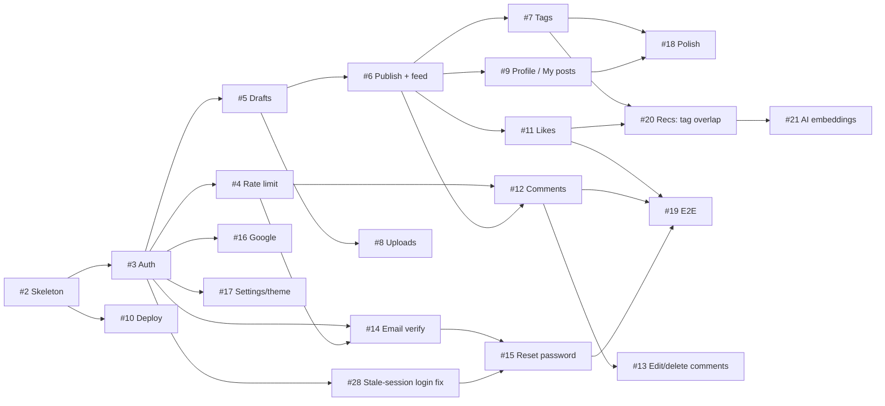

# Pencil roadmap

How agents work through the Pencil build. The spec is [#1](https://github.com/ja03/pencil/issues/1). The work is split into 21 tickets, issues [#2](https://github.com/ja03/pencil/issues/2)–[#21](https://github.com/ja03/pencil/issues/21) plus [#28](https://github.com/ja03/pencil/issues/28) (a fix found while building #6), each a sub-issue of #1 labelled `ready-for-agent`, with GitHub's native "blocked by" links.

The issues are the source of truth. This file explains the order and the reasons behind it. If an issue and this file disagree, follow the issue and fix this file.

## Picking the next issue

Work the **frontier**: an open sub-issue of #1 with no open blockers and no assignee. When several are free, take the lowest number. The numbering follows the spec's build order, so a single agent can work #2 → #21 in order, with one exception: #28 was added later and must land before #15.

```bash
gh api repos/ja03/pencil/issues/1/sub_issues --jq '.[] | select(.state=="open" and (.assignees|length)==0) | .number' \
  | while read n; do
      open=$(gh api repos/ja03/pencil/issues/$n --jq .issue_dependencies_summary.blocked_by)
      if [ "$open" = "0" ]; then echo "#$n"; fi
    done
```

The first number printed is the next issue. Then:

1. **Claim it:** `gh issue edit <n> --add-assignee @me`. Do this before any other write.
2. **Read it in full:** its body, its comments, and the parts of #1 it touches.
3. **Build it test-first:** follow the rules below.
4. **Open a PR:** put `Closes #<n>` in the body. Merging the PR closes the issue and unblocks the issues that depend on it.

Don't start an issue that still has an open blocker, even if most of the code it needs looks like it's already there.

## Rules for every issue

These come from the spec and apply to all tickets. Each ticket assumes them without repeating them.

- **Layers:** a request goes through the route handler (parse, validate with Zod, map to HTTP), then the service (business rules, ownership, verification gates), then the repository (all queries), then Prisma. Each layer only calls the one below it.
- **REST:** every create, read, update and delete goes through REST route handlers. Server Actions alone don't count.
- **Shared contracts:** Zod schemas are the only source of validated input types. Request and response shapes are typed contracts shared by the API and the client.
- **One error shape:** `{ error: { code, message, fields? } }`.
  - 400: validation failed.
  - 401: not signed in, or the session is stale.
  - 403: the user is unverified, or isn't the owner.
  - 404: the resource is missing, is someone else's draft, or is soft-deleted.
  - 409: a conflict.
  - 429: rate-limited.
- **Testing:** the main test seam is the REST route handlers, run against a real test Postgres (with pgvector), Mailpit and MinIO.
  - Don't use fake repositories.
  - Only fake external boundaries: the embedding provider, the clock and the Google token verifier.
  - Pure unit tests are only for pure functions.
  - Tests assert on HTTP behaviour and side effects, never on internal calls.
- **Definition of done:** CI is green (audit, lint, typecheck, unit and feature tests with coverage, plus E2E once [#19](https://github.com/ja03/pencil/issues/19) has landed), and every acceptance criterion on the issue is ticked.

## Dependency graph



**Critical path:** #2 → #3 → #5 → #6 → #7 → #20 → #21, which is 7 issues in a row. Delays on this path delay the whole build, so give these issues priority.

## Waves

A wave is a set of issues that can run in parallel once every earlier wave is merged. With one agent, ignore the waves and work in number order.

| Wave | Issues | Unlocks |
| --- | --- | --- |
| 0 | #2 | Everything |
| 1 | #3, #10 | Auth unlocks most of the remaining work. Deploy runs on its own track. |
| 2 | #4, #5, #16, #17, #28 | Drafts, rate limiting, Google sign-in, settings, the stale-session login fix |
| 3 | #6, #8, #14 | The feed, uploads, the email pipeline |
| 4 | #7, #9, #11, #12, #15 | Social features, tags, profile, password reset |
| 5 | #13, #18, #19, #20 | Finishing work, E2E tests, recommendations |
| 6 | #21 | Done |

**Running agents in parallel:** most tickets add to the Prisma schema, and two branches that each add a migration will conflict.
- When this happens, rebase onto `main` and regenerate the migration. Never hand-merge two migration files.
- Don't run two agents in parallel on issues that both change the same model.

## Phases

These are the build phases from the spec, in order, matched to their issues.

### 1. Foundation

**[#2 Walking skeleton](https://github.com/ja03/pencil/issues/2)**
- **Blocked by:** nothing.
- **Unlocks:** #3 and #10.
- **Why it matters:** this ticket sets the patterns every later ticket copies:
  - test database reset
  - the request helper
  - the error-shape helper
  - the layer structure
  - the `globalThis` singletons
  - the CI pipeline
- **Watch out:** get these patterns right here, because changing them later means touching every test.

### 2. Auth

**[#3 Register, log in and log out](https://github.com/ja03/pencil/issues/3)**
- **Blocked by:** #2.
- **Unlocks:** #4, #5, #14, #16, #17 and #28.
- **Watch out:**
  - The current-user entry point that checks `tokenVersion` is what every protected handler uses. Build it once, here.
  - `makeStore()` must create a new store per request, never a global.
  - This ticket also adds the authenticated-cookie test helper that later tickets rely on.

**[#4 Rate limiting keyed on the real client IP](https://github.com/ja03/pencil/issues/4)**
- **Blocked by:** #3.
- **Unlocks:** #12 and #14.
- **Watch out:**
  - Build a reusable limiter that takes the clock as a dependency. Comment creation (#12) and resending verification (#14) reuse it.
  - The client IP comes from the rightmost `X-Forwarded-For` entry, read through one helper.
  - #10 checks this assumption in production.

**[#28 Let stale sessions reach the login and register pages](https://github.com/ja03/pencil/issues/28)**
- **Blocked by:** #3.
- **Unlocks:** #15.
- **Why it exists:** found while building #6. `src/proxy.ts` only checks a cookie's signature and expiry, so a stale cookie (deleted user, or bumped `tokenVersion`) still counts as signed in there. The proxy then redirects `/login` and `/register` to `/`, and the visitor can't log in again until they clear cookies.
- **Watch out:**
  - The proxy must stay free of database access.
  - It must land before #15: a password reset makes every other session stale, and #15's session-expired screen sends people to `/login`.

### 3. Posts

**[#5 Write and edit draft posts](https://github.com/ja03/pencil/issues/5)**
- **Blocked by:** #3.
- **Unlocks:** #6 and #8.
- **Watch out:**
  - The server checks content against the whitelist, so content sent straight to the API is checked too, not only what the editor produces.
  - The slug is fixed when the post is created and never changes.
  - Other users get 404 on a draft, never 403.
  - #8 extends the same content check with an image-origin rule.

**[#8 Upload cover and inline images](https://github.com/ja03/pencil/issues/8)**
- **Blocked by:** #5.
- **Unlocks:** nothing.
- **Watch out:**
  - Detect the file type from its bytes, not its extension.
  - Uploads go through the API. The browser never uploads straight to storage.
  - Image nodes in post content must point at Pencil's own storage, so no tracking pixels from other sites.

### 4. Feed and pages

**[#6 Publish posts and browse the public feed](https://github.com/ja03/pencil/issues/6)**
- **Blocked by:** #5.
- **Unlocks:** #7, #9, #11 and #12.
- **Watch out:**
  - This is the main hub: four issues wait on it.
  - Unverified users get 403 when publishing. Seed users must be verified so publishing can be demoed before #14 lands.
  - The cursor is (`publishedAt`, `id`), and a feature test must show no duplicates when a post is published between page loads.

**[#7 Tags on posts and tag pages](https://github.com/ja03/pencil/issues/7)**
- **Blocked by:** #6.
- **Unlocks:** #18 and #20.
- **Watch out:** this is on the critical path. Tag pages reuse the feed query from #6.

**[#9 Author profiles, My posts dashboard and post deletion](https://github.com/ja03/pencil/issues/9)**
- **Blocked by:** #6.
- **Unlocks:** #18.
- **Watch out:** deleting a post sets `deletedAt` and nothing else; there is no hard delete. Every query that lists posts must leave out deleted posts.

### 5. Deploy (ship early)

**[#10 Deploy to Render from CI](https://github.com/ja03/pencil/issues/10)**
- **Blocked by:** #2.
- **Unlocks:** nothing.
- **When to do it:** it can technically start right after the skeleton. The spec says to ship after the feed and pages so the live site has something to show, and number order puts it there.
- **Watch out:**
  - Log `X-Forwarded-For` once in production to confirm the assumption #4 relies on.
  - The free Render tier sleeps when idle.

### 6. Social

**[#11 Like and unlike posts](https://github.com/ja03/pencil/issues/11)**
- **Blocked by:** #6.
- **Unlocks:** #19 and #20.
- **Watch out:**
  - The unique (`userId`, `postId`) constraint is what stops duplicate likes. Prove it with a feature test that sends concurrent requests.
  - The UI updates the count straight away and rolls it back if the request fails.

**[#12 Comment on posts and reply to comments](https://github.com/ja03/pencil/issues/12)**
- **Blocked by:** #4 and #6.
- **Unlocks:** #13 and #19.
- **Watch out:**
  - Replies only go one level deep: a reply to a reply gets 400.
  - Top-level comments come newest first, 20 per page; replies come oldest first, all at once.
  - Comment creation is rate-limited with the limiter from #4.

**[#13 Edit and delete comments](https://github.com/ja03/pencil/issues/13)**
- **Blocked by:** #12.
- **Unlocks:** nothing.
- **Watch out:**
  - A deleted comment that has replies shows "[comment deleted]" and keeps its replies.
  - A deleted comment with no replies disappears.
  - The post's author can delete any comment on their post.
  - #12 left `deletedAt` and the edited marker off the `comments` table, so this ticket's migration adds them. Then make comment counts on cards and the post (`_count.comments`) and the comment list agree with what a reader sees.

### 7. Email

**[#14 Email verification](https://github.com/ja03/pencil/issues/14)**
- **Blocked by:** #3 and #4.
- **Unlocks:** #15.
- **Watch out:**
  - This ticket builds the mailer and the token module (hashed, single-use tokens with an expiry). #15 reuses both.
  - Resend gives the same reply whether or not the account exists.

**[#15 Forgot and reset password](https://github.com/ja03/pencil/issues/15)**
- **Blocked by:** #14 and #28.
- **Unlocks:** #19.
- **Watch out:**
  - A reset bumps `tokenVersion`, so the old cookie must get 401 afterwards.
  - The "forgot password" reply never reveals whether the account exists.

### 8. Google sign-in

**[#16 Google sign-in and account linking](https://github.com/ja03/pencil/issues/16)**
- **Blocked by:** #3.
- **Unlocks:** nothing.
- **Watch out:**
  - Google links to an existing account only when Google marks the email as verified.
  - In the takeover case, removing the squatter's password and bumping `tokenVersion` happen in one transaction.
  - When Google isn't configured, hide the button. Nothing else should break.

### 9. Polish

**[#17 Settings page and theme switching](https://github.com/ja03/pencil/issues/17)**
- **Blocked by:** #3.
- **Unlocks:** nothing.
- **Watch out:** the theme is stored in a cookie so the server renders the right theme and there's no flash on load.

**[#18 Polish reading pages](https://github.com/ja03/pencil/issues/18)**
- **Blocked by:** #7 and #9.
- **Unlocks:** nothing.
- **Scope:**
  - custom 404 and 500 pages
  - Open Graph tags from `generateMetadata`
  - skeletons and empty states that earlier tickets didn't cover
  - a responsive pass in light and dark
- **Watch out:** the UI Design (linked from #1) has every variant.

### 10. Tests completed

**[#19 End-to-end tests for the core journeys](https://github.com/ja03/pencil/issues/19)**
- **Blocked by:** #11, #12 and #15.
- **Unlocks:** nothing.
- **Scope:** two Playwright journeys, kept short. The verification link is read from Mailpit's API.
- **Watch out:** once this ticket lands, E2E tests gate the deploy in CI.

### 11. AI recommendations (last, can be dropped)

**[#20 Recommendations using tag overlap](https://github.com/ja03/pencil/issues/20)**
- **Blocked by:** #7 and #11.
- **Unlocks:** #21.
- **Watch out:**
  - Build the `RecommendationStrategy` interface and its factory here.
  - When there's nothing to go on, show the most-liked posts of the last 30 days.
  - Never recommend the user's own posts, posts they already liked, drafts, or deleted posts.

**[#21 AI recommendations with embeddings](https://github.com/ja03/pencil/issues/21)**
- **Blocked by:** #20.
- **Unlocks:** nothing.
- **Watch out:**
  - Embedding runs in `after()`. A failure must never affect the save.
  - Only re-embed when the title, description or tags change.
  - Tests use the fake provider and never call Gemini.

## If time runs out

The spec targets one day of work. Cut from the end, in this order:

1. **#21:** the tag-overlap fallback still provides recommendations.
2. **#20:** this removes the AI feature completely without leaving anything half-built.
3. **#18:** visual polish only. The 404 behaviour itself is already covered by tests in #5 and #9.

Never cut these, because they cover graded requirements: #2, #3, #5, #6, #9, #10, #11, #12 and #19.

## Not ticketed yet

- **README and design-pattern write-up:** the spec's last build step. The patterns to document are Singleton, Repository + Service, Factory, Middleware and Strategy. Add a ticket blocked by #10, #19 and #21 (or #20 if #21 is cut) when needed.
